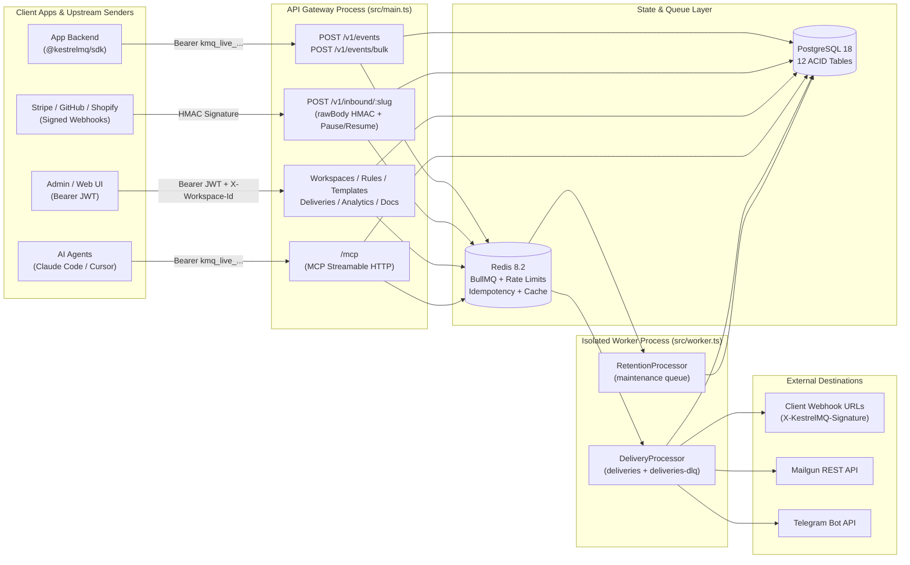

# KestrelMQ

[](https://nodejs.org)
[](https://www.typescriptlang.org)
[](https://www.postgresql.org)
[](https://redis.io)
[](#mcp-server-integration-mcp)
[](https://opensource.org/licenses/MIT)

**Self-hosted, multi-tenant notification orchestration and guaranteed webhook delivery platform.**

KestrelMQ decouples outbound notifications (Webhooks, Email via Mailgun, Telegram Bot API) and inbound third-party webhooks (Stripe, Shopify, GitHub, Custom HMAC) from primary application backends with transactional persistence, BullMQ exponential backoff retries, cryptographic secret storage, and zero-downtime deployment buffering.

---

## Table of Contents

- [Core Capabilities](#core-capabilities)
- [Architecture Overview](#architecture-overview)
- [Technology Stack](#technology-stack)
- [Quickstart](#quickstart)
- [Zero to First Delivered Webhook in 3 Minutes](#zero-to-first-delivered-webhook-in-3-minutes)
- [Server Configuration, Rate Limits & Data Retention](#server-configuration-rate-limits--data-retention)
  - [Environment Variables Reference](#environment-variables-reference)
  - [Workspace Plan Quotas & Self-Hosted Overrides](#workspace-plan-quotas--self-hosted-overrides)
  - [Rate Limit Response Headers](#rate-limit-response-headers)
- [Production Deployment & Operations](#production-deployment--operations)
  - [Database Migrations](#database-migrations)
  - [Reverse Proxy (Caddy & Nginx)](#reverse-proxy-caddy--nginx)
  - [Horizontal Scaling & Zero-Downtime Deploys](#horizontal-scaling--zero-downtime-deploys)
- [Bulk CSV Ingestion Format](#bulk-csv-ingestion-format)
- [Interactive OpenAPI / Swagger Documentation](#interactive-openapi--swagger-documentation-docs)
- [`@kestrelmq/sdk` Usage](#kestrelmqsdk-usage)
- [MCP Server Integration](#mcp-server-integration-mcp)
- [Testing & Verification Commands](#testing--verification-commands)

---

## Core Capabilities

- **Strict API vs. Worker Separation:** The HTTP API Gateway (`src/main.ts`) validates, persists, and enqueues events in `<10ms` (`202 Accepted`) without ever performing external HTTP calls. Isolated background workers (`src/worker.ts`) execute deliveries, decrypt credentials in memory, and record audit trails.
- **At-Least-Once Delivery & Jittered Backoff:** Automatic retry progression (`10s -> 1m -> 5m -> 30m -> 2h` with ±10% jitter, max 5 attempts), fatal `4xx` vs. transient `429`/`5xx`/network classification, Dead Letter Queue (`deliveries-dlq`), and manual `Replay` / `Cancel`.
- **Cryptographic Security:**
  - `AES-256-GCM` AEAD encryption at rest for provider credentials and inbound signing secrets.
  - `SHA-256` hashed workspace API keys (`kmq_live_...`) with 300s Redis lookup caching.
  - `Argon2id` user password hashing + atomic Redis Lua refresh-token rotation with OAuth 2.0 reuse detection.
  - Outbound `X-KestrelMQ-Timestamp` + `X-KestrelMQ-Signature` (`v1=<hmac-sha256>`) webhook signing.
  - Recursive sensitive-key redaction across logs and `delivery_attempts` audit snapshots.
- **Routing, Templating & Schema Contracts:** Wildcard (`order.*`, `*`) and prototype-safe JsonLogic rule evaluation, sandboxed Handlebars templates with Bring-Your-Own-Template (BYOT) fallback, Sample-to-Schema JSON Schema inference, and Ajv validation (`DISABLED`, `WARN`, `STRICT`).
- **Inbound Webhook Gateway & Buffering:** Constant-time `rawBody` HMAC verification (`Stripe`, `Shopify`, `GitHub`, `Custom HMAC`), ingress/egress rate shaping, and `Pause` / `Resume` buffering during downstream deployments or migrations.
- **High-Throughput Operations:** Backpressure-driven RFC 4180 streaming CSV bulk ingestion (`POST /v1/events/bulk`), zero-`OFFSET` keyset cursor pagination, plan-aware Redis ZSET sliding-window rate limiting, 60s Cache-Aside analytics (`PERCENTILE_CONT(0.95)`), and daily plan-aware retention cleanup.
- **Typed SDK & OpenAPI Docs:** Zero-dependency `@kestrelmq/sdk` TypeScript client with RFC 9457 `KestrelApiError` parsing and interactive Swagger UI at `/docs`.
- **MCP Server for AI Agents:** Official `@nestjs/mcp` Streamable HTTP server at `/mcp`. It exposes six tenant-isolated tools and two discovery resources to Claude Code, Cursor, and other MCP clients, authenticated with workspace API keys.

---

## Architecture Overview



---

## Technology Stack

| Layer | Technology |
| :--- | :--- |
| **Runtime & Language** | Node.js 26 LTS (`>=22.12.0` compatible), TypeScript 6.0 (`strict`, ESM `nodenext`) |
| **Framework** | NestJS 12 (`@nestjs/platform-express`, `@nestjs/bullmq`, `@nestjs/swagger`) |
| **Database & ORM** | PostgreSQL 18 Alpine + Prisma 7 (`prisma-client` ESM generator + `@prisma/adapter-pg`) |
| **Queues & Caching** | Redis 8.2 Alpine + BullMQ 6 + `ioredis` Lua scripts |
| **AI Agent Integration** | `@nestjs/mcp` + `@modelcontextprotocol/server` (stateless Streamable HTTP), Zod 4 tool schemas |
| **Testing** | Vitest 5 + `@testcontainers/postgresql` & `@testcontainers/redis` |

---

## Quickstart

### 1. Configure Environment Variables

Copy `.env.example` to `.env` and generate cryptographic secrets:

```bash
cp .env.example .env
```

Generate random secrets with OpenSSL and populate `.env`:

```bash
# Generate 64-hex-char AES-256-GCM master key (32 bytes) and distinct signing secrets:
openssl rand -hex 32   # -> ENCRYPTION_MASTER_KEY
openssl rand -hex 32   # -> APP_SECRET
openssl rand -hex 32   # -> JWT_ACCESS_SECRET
openssl rand -hex 32   # -> JWT_REFRESH_SECRET
```

### 2. Local Development (Infrastructure in Docker, App on Host)

Start PostgreSQL 18 and Redis 8.2:

```bash
docker compose up -d postgres redis
```

Install dependencies, generate the Prisma 7 ESM client, and apply migrations:

```bash
npm install
npx prisma generate
npx prisma migrate deploy
```

Start the **HTTP API Gateway** and the **Background Worker** in separate terminals:

```bash
# Terminal 1 — HTTP API Gateway (http://localhost:3000)
npm run start:dev

# Terminal 2 — Standalone BullMQ Worker (no HTTP listener)
npm run start:worker:dev
```

### 3. Full Production Deployment with Docker Compose

Build the multi-stage Alpine image (runs as non-root `USER node`) and start `postgres`, `redis`, `api`, and `worker`:

```bash
docker compose --profile full up --build -d
```

Or build and run the immutable image directly with separate entrypoints:

```bash
docker build -t kestrelmq:latest .

# Run HTTP API Gateway
docker run --rm -p 3000:3000 --env-file .env kestrelmq:latest node dist/main.js

# Run Isolated BullMQ Worker
docker run --rm --env-file .env kestrelmq:latest node dist/worker.js
```

---

## Zero to First Delivered Webhook in 3 Minutes

A fresh instance has no users, workspaces, or keys. This walkthrough bootstraps one end to end with `curl` and `jq`, against either deployment mode from the [Quickstart](#quickstart). Both the API and the worker must be running.

Pick a webhook target you can inspect (any HTTPS request bin, or a local receiver). If the worker runs in Docker and the receiver runs on your host, use `http://host.docker.internal:<port>` (Docker Desktop; on Linux add `extra_hosts: ["host.docker.internal:host-gateway"]` to the `worker` service).

```bash
export KMQ=http://localhost:3000
export WEBHOOK_URL=https://your-receiver.example.com/kestrelmq
```

**1. Register the first user** (`POST /v1/auth/register`) and capture the access token (valid for `JWT_ACCESS_TTL_SEC`, 15 minutes by default):

```bash
ACCESS_TOKEN=$(curl -sf -X POST "$KMQ/v1/auth/register" \
  -H 'Content-Type: application/json' \
  -d '{"email":"ops@example.com","password":"change-me-Str0ng!","fullName":"Platform Ops"}' \
  | jq -r '.accessToken')
```

Passwords must be 8–128 characters. When the token expires, sign in again with `POST /v1/auth/login` (`email`, `password`).

**2. Create a workspace** (`POST /v1/workspaces`). The creator becomes `OWNER`. The response also contains `webhookSigningSecret`, the HMAC key your receivers use to [verify `X-KestrelMQ-Signature`](#verifying-outbound-webhook-signatures-x-kestrelmq-signature); store it now.

```bash
WORKSPACE=$(curl -sf -X POST "$KMQ/v1/workspaces" \
  -H "Authorization: Bearer $ACCESS_TOKEN" \
  -H 'Content-Type: application/json' \
  -d '{"name":"Acme Commerce","slug":"acme-commerce"}')
WORKSPACE_ID=$(echo "$WORKSPACE" | jq -r '.id')
WEBHOOK_SIGNING_SECRET=$(echo "$WORKSPACE" | jq -r '.webhookSigningSecret')
```

**3. Generate a workspace API key** (`POST /v1/workspaces/:id/api-keys`, `OWNER` or `ADMIN`). The plaintext `kmq_live_...` key is returned once; only its SHA-256 hash is stored.

```bash
KMQ_API_KEY=$(curl -sf -X POST "$KMQ/v1/workspaces/$WORKSPACE_ID/api-keys" \
  -H "Authorization: Bearer $ACCESS_TOKEN" \
  -H 'Content-Type: application/json' \
  -d '{"name":"Production Checkout Service"}' \
  | jq -r '.apiKey')
```

**4. Create an outbound webhook integration and a routing rule.** Management routes take the JWT plus the target workspace in `X-Workspace-Id`. Credentials are encrypted with AES-256-GCM before they are stored.

```bash
INTEGRATION_ID=$(curl -sf -X POST "$KMQ/v1/integrations" \
  -H "Authorization: Bearer $ACCESS_TOKEN" \
  -H "X-Workspace-Id: $WORKSPACE_ID" \
  -H 'Content-Type: application/json' \
  -d "$(jq -n --arg url "$WEBHOOK_URL" \
        '{name:"Order Fulfillment Webhook",channel:"WEBHOOK",provider:"CUSTOM_WEBHOOK",credentials:{url:$url}}')" \
  | jq -r '.id')

curl -sf -X POST "$KMQ/v1/rules" \
  -H "Authorization: Bearer $ACCESS_TOKEN" \
  -H "X-Workspace-Id: $WORKSPACE_ID" \
  -H 'Content-Type: application/json' \
  -d "$(jq -n --arg id "$INTEGRATION_ID" '{eventName:"order.paid",integrationId:$id}')" | jq
```

`eventName` also accepts wildcards (`order.*`, `*`). Optional rule fields are `templateId`, `targetOverride` and `isActive`. Webhook target resolution order: `targetOverride` (a literal URL, or a `payload.*` / `recipient.*` dot-path), then `recipient.webhookUrl` on the event, then the integration's `credentials.url`.

**5. Send a test event** (`POST /v1/events`, API key auth) **and verify delivery** (`GET /v1/deliveries`):

```bash
curl -s -X POST "$KMQ/v1/events" \
  -H "Authorization: Bearer $KMQ_API_KEY" \
  -H 'Content-Type: application/json' \
  -H 'Idempotency-Key: order-paid-ord_9001' \
  -d '{"event":"order.paid","payload":{"orderId":"ord_9001","amount":149.99}}' \
  | jq '{eventId, deliveryIds}'

sleep 2

curl -s "$KMQ/v1/deliveries?limit=5" \
  -H "Authorization: Bearer $KMQ_API_KEY" \
  | jq '.data[] | {id, status, attemptCount, event: .event.eventName}'
```

The event returns `202 Accepted` (or `200` when the same `Idempotency-Key` is replayed within 24h). A healthy pipeline shows `"status": "DELIVERED"`. For the full attempt timeline (masked request payload, response status and body, error message, duration), call `GET /v1/deliveries/:id`. Failed deliveries can be retried with `POST /v1/deliveries/:id/replay`.

| Symptom | Likely cause |
| :--- | :--- |
| `deliveryIds` is empty | No active rule matches the event name. |
| Status stays `PENDING` | The worker process is not running, or it cannot reach Redis. |
| Status `RETRYING` | Target returned `429`/`5xx` or timed out (10s); the retry schedule is `10s -> 1m -> 5m -> 30m -> 2h`. |
| Status `FAILED` after one attempt | Target returned a non-`429` `4xx` (fatal, not retried). |

---

## Server Configuration, Rate Limits & Data Retention

### Environment Variables Reference

Both processes validate their environment with Zod at boot (`src/config/env.validation.ts`) and refuse to start on any violation, printing every failing field.

| Variable | Type | Default | Required | Description |
| :--- | :--- | :--- | :---: | :--- |
| `NODE_ENV` | `development` \| `production` \| `test` | `development` | No | Runtime mode. `test` skips loading `.env` (used by the Testcontainers E2E suite). |
| `PORT` | integer `1`–`65535` | `3000` | No | HTTP listen port of the API gateway. The worker has no HTTP listener. |
| `POSTGRES_URL` | `postgres://` or `postgresql://` URL | — | **Yes** | PostgreSQL connection string used by Prisma (`@prisma/adapter-pg`) and `prisma migrate`. |
| `REDIS_URL` | `redis://` or `rediss://` URL | — | **Yes** | Redis connection for BullMQ queues, rate limits, idempotency locks, refresh-token families, and caches. Use `rediss://` for TLS. |
| `APP_SECRET` | string, min 32 chars | — | **Yes** | Application secret, validated at boot. Not consumed by any module yet; reserved for application-level signing. |
| `ENCRYPTION_MASTER_KEY` | exactly 64 hex chars (32 bytes) | — | **Yes** | AES-256-GCM master key for integration credentials and inbound signing secrets. Changing it makes existing encrypted rows unreadable. |
| `JWT_ACCESS_SECRET` | string, min 32 chars | — | **Yes** | HMAC secret for access JWTs. Must differ from `JWT_REFRESH_SECRET`. |
| `JWT_REFRESH_SECRET` | string, min 32 chars | — | **Yes** | HMAC secret for refresh JWTs. Must differ from `JWT_ACCESS_SECRET`. |
| `JWT_ACCESS_TTL_SEC` | positive integer | `900` | No | Access token lifetime (15 minutes). |
| `JWT_REFRESH_TTL_SEC` | positive integer | `604800` | No | Refresh token lifetime (7 days). |
| `RATE_LIMIT_WINDOW_MS` | positive integer | `60000` | No | Sliding-window length for the per-workspace API quota. |
| `RATE_LIMIT_FREE_MAX` | positive integer | `60` | No | Requests per window for `FREE` workspaces. |
| `RATE_LIMIT_PRO_MAX` | positive integer | `600` | No | Requests per window for `PRO` workspaces. |
| `RATE_LIMIT_ENTERPRISE_MAX` | positive integer | `3000` | No | Requests per window for `ENTERPRISE` workspaces. |
| `BACKOFF_SCALE_FACTOR` | positive number | `1` | No | Multiplier applied to the retry schedule (`10s -> 1m -> 5m -> 30m -> 2h`). Keep `1` in production; tests use small values to compress retries. |

`docker-compose.yml` additionally reads these from `.env` to provision the bundled containers:

| Variable | Default | Description |
| :--- | :--- | :--- |
| `POSTGRES_USER`, `POSTGRES_PASSWORD`, `POSTGRES_DB` | — (required) | Credentials of the bundled PostgreSQL container. The `api` and `worker` services build `POSTGRES_URL` from them. |
| `POSTGRES_PORT` | `5432` | Host port published for PostgreSQL. |
| `REDIS_PORT` | `6379` | Host port published for Redis. |

> **Compose precedence:** the `api` and `worker` services load the whole `.env` via `env_file`, so optional tuning such as `RATE_LIMIT_*` and `BACKOFF_SCALE_FACTOR` applies without extra configuration. Their explicit `environment:` block still wins for `NODE_ENV` (`production`), `PORT` (`3000`, API only), and the container-network `POSTGRES_URL` / `REDIS_URL`, so the host-oriented `localhost` URLs in `.env` do not leak into containers. Host processes (`npm run start:*`) and `docker run --env-file .env` read every variable directly.

### Workspace Plan Quotas & Self-Hosted Overrides

Every workspace has a `plan` (`workspaces.plan`, default `FREE`). The plan selects the API quota enforced by `RateLimitGuard` and the audit-trail retention applied by the worker.

| Plan | API quota (default) | `delivery_attempts` retention |
| :--- | :--- | :--- |
| `FREE` | `60` requests / `60s` sliding window | `7d` |
| `PRO` | `600` requests / `60s` sliding window | `30d` |
| `ENTERPRISE` | `3000` requests / `60s` sliding window | `90d` |

**Where the quota applies.** The guard counts requests per workspace (not per client IP) in a Redis ZSET (`ratelimit:workspace:<workspaceId>`) on API-key authenticated traffic: `POST /v1/events`, `POST /v1/events/bulk` (one upload counts as one request), and every request to `/mcp`. Management, delivery, and analytics routes are not quota-limited. Rejected requests are not added to the window. Public inbound webhooks (`POST /v1/inbound/:sourceSlug`) use a separate per-source limit of `maxRatePerSec` requests per second (default `10`, max `10000`), set when the inbound source is created.

**Retention.** On startup the worker registers a BullMQ job scheduler on the `maintenance` queue that runs `cleanup-delivery-attempts` daily at `03:00` (cron `0 3 * * *`, evaluated in the worker's time zone; UTC in the default container image). For each plan it deletes `delivery_attempts` rows older than the retention period in batches of `1,000` rows, up to `100` batches per plan per run. Rows in `events` and `deliveries` are not purged. Retention periods are compile-time constants (`RETENTION_DAYS_BY_PLAN` in `src/modules/worker/retention.processor.ts`), not environment variables.

**Self-hosted overrides.** There is no billing layer, so operators choose one of two approaches:

1. **Raise quotas globally** through `.env` (applies to every workspace of that plan; restart the API to apply, e.g. `docker compose --profile full up -d api`, which recreates the container with the new values):

   ```bash
   RATE_LIMIT_WINDOW_MS=60000
   RATE_LIMIT_FREE_MAX=1200
   RATE_LIMIT_PRO_MAX=6000
   RATE_LIMIT_ENTERPRISE_MAX=30000
   ```

2. **Promote a workspace to `ENTERPRISE`** in PostgreSQL to get the highest quota and 90-day retention:

   ```bash
   docker compose exec postgres sh -c \
     'psql -U "$POSTGRES_USER" -d "$POSTGRES_DB" -c "UPDATE workspaces SET plan = '\''ENTERPRISE'\'' WHERE id = '\''<workspace-uuid>'\'';"'

   # The resolved plan is cached in Redis for 300s; drop the cache entry to apply immediately
   docker compose exec redis redis-cli DEL workspace:plan:<workspace-uuid>
   ```

### Rate Limit Response Headers

Every request that passes through `RateLimitGuard` carries:

| Header | When | Value |
| :--- | :--- | :--- |
| `X-RateLimit-Limit` | Always | Quota for the workspace's plan in the current window. |
| `X-RateLimit-Remaining` | Always | Requests left in the window (`0` when rejected). |
| `Retry-After` | `429` only | Seconds until the oldest request leaves the window (minimum `1`). |

An exceeded quota returns `429 Too Many Requests` with an RFC 9457 `application/problem+json` body:

```http
HTTP/1.1 429 Too Many Requests
Content-Type: application/problem+json
X-RateLimit-Limit: 60
X-RateLimit-Remaining: 0
Retry-After: 17

{
  "type": "https://errors.kestrelmq.io/too-many-requests",
  "title": "Too Many Requests",
  "status": 429,
  "detail": "Workspace rate limit exceeded",
  "instance": "/v1/events",
  "timestamp": "2026-11-27T10:15:42.120Z"
}
```

Inbound sources answer `429` with `Retry-After` in the same format (`detail`: `Inbound webhook rate limit exceeded`). Whether the sender retries depends on the provider (Stripe and Shopify retry failed deliveries automatically; GitHub requires a manual redelivery). The SDK exposes the header as `KestrelApiError.retryAfterSec`.

---

## Production Deployment & Operations

### Database Migrations

The runtime image prunes dev dependencies, so the `prisma` CLI is not available inside the `api`/`worker` containers. Apply migrations from a checkout (or a CI job) before starting new application versions:

```bash
POSTGRES_URL='postgresql://kestrelmq:<password>@db.internal:5432/kestrelmq?schema=public' \
  npx prisma migrate deploy
```

With the bundled Compose stack, PostgreSQL is published on `localhost:${POSTGRES_PORT:-5432}`, so the `POSTGRES_URL` from `.env.example` works as-is.

### Reverse Proxy (Caddy & Nginx)

Put a TLS-terminating proxy in front of the API gateway on `:3000`. Requirements:

- **Forward client addresses** with `X-Forwarded-For` / `X-Real-IP` for access logs. Quotas are keyed by workspace, not IP, so they are unaffected by proxying.
- **Pass request bodies through byte-for-byte.** Inbound signatures (`Stripe-Signature`, `X-Hub-Signature-256`, `X-Shopify-Hmac-Sha256`, `X-KestrelMQ-Signature`) are verified over the raw body (`rawBody: true`). Do not enable body rewriting, re-encoding, or WAF normalization on `/v1/inbound/`.
- **Allow bulk uploads**: CSV files may be up to 10 MiB, plus multipart overhead.
- **Disable response buffering on `/mcp`** so Streamable HTTP responses reach MCP clients as they are written.

**Caddy** (`Caddyfile`, automatic HTTPS; `X-Forwarded-For` is set by default):

```caddyfile
kestrelmq.example.com {
	request_body {
		max_size 11MB
	}

	handle /mcp* {
		reverse_proxy 127.0.0.1:3000 {
			flush_interval -1
			header_up X-Real-IP {remote_host}
		}
	}

	handle {
		reverse_proxy 127.0.0.1:3000 {
			header_up X-Real-IP {remote_host}
		}
	}
}
```

**Nginx:**

```nginx
upstream kestrelmq_api {
    server 127.0.0.1:3000;
    keepalive 32;
}

server {
    listen 443 ssl;
    http2 on;
    server_name kestrelmq.example.com;

    ssl_certificate     /etc/ssl/kestrelmq/fullchain.pem;
    ssl_certificate_key /etc/ssl/kestrelmq/privkey.pem;

    client_max_body_size 11m;   # 10 MiB CSV + multipart overhead

    proxy_http_version 1.1;
    proxy_set_header Connection        "";
    proxy_set_header Host              $host;
    proxy_set_header X-Real-IP         $remote_addr;
    proxy_set_header X-Forwarded-For   $proxy_add_x_forwarded_for;
    proxy_set_header X-Forwarded-Proto $scheme;

    location / {
        proxy_pass http://kestrelmq_api;
    }

    # Stream bulk CSV uploads straight to the backpressure-aware parser
    location = /v1/events/bulk {
        proxy_request_buffering off;
        proxy_pass http://kestrelmq_api;
    }

    # Streamable HTTP for MCP clients
    location /mcp {
        proxy_buffering    off;
        proxy_cache        off;
        proxy_read_timeout 300s;
        proxy_pass http://kestrelmq_api;
    }
}
```

Compose publishes the API on `0.0.0.0:${PORT}` and PostgreSQL/Redis on their host ports. On an internet-facing host, firewall those ports so only the proxy is reachable.

### Horizontal Scaling & Zero-Downtime Deploys

The API gateway and the worker are separate processes from the same image (`node dist/main.js` / `node dist/worker.js`) and scale independently:

- **API (`api`)** is stateless: JWT auth, Redis-backed refresh tokens, idempotency, and rate limits, plus stateless MCP (no session affinity). Run as many replicas as needed behind the proxy.
- **Workers (`worker`)** compete for jobs on the shared `deliveries` queue. Each process runs `10` concurrent delivery jobs and one `maintenance` job at a time; the retention scheduler is upserted by ID, so multiple workers do not duplicate it.

```bash
docker compose --profile full up -d --scale worker=3
```

> `api` and `worker` have no fixed `container_name`, so Compose names replicas `<project>-worker-1`, `<project>-worker-2`, and so on. Use service names in commands (`docker compose logs -f worker`, `docker compose exec api sh`). Scaling `api` on one host additionally requires dropping its fixed `ports` mapping (`${PORT}:3000` can bind only once) and routing through the proxy or a load balancer.

**Graceful worker shutdown.** On `SIGTERM`/`SIGINT` the worker stops taking new jobs, waits for in-flight deliveries to finish, closes its connections, and exits `0`. A single webhook attempt is bounded by a 10s timeout, but Docker sends `SIGKILL` after 10s by default, so give workers more headroom:

```yaml
# docker-compose.override.yml
services:
  worker:
    stop_grace_period: 30s
```

If a worker is killed mid-job anyway, BullMQ marks the job stalled and another worker picks it up. Delivery is at-least-once, so receivers should deduplicate.

**Rolling deploy order:**

1. Apply migrations (`npx prisma migrate deploy`).
2. Roll workers: start new worker replicas, then stop old ones with `SIGTERM`; in-flight jobs drain.
3. Roll API replicas one at a time behind the proxy. Accepted events are already persisted and queued in PostgreSQL/Redis, so no traffic is lost while either tier restarts.

**Downstream maintenance with Inbound `Pause` / `Resume`.** When the service behind an inbound source's `targetUrl` is being deployed or migrated, pause the source instead of letting deliveries fail and burn retries:

```bash
# Buffer: keep accepting provider webhooks (200, "buffered": true) and park queued deliveries as PAUSED
curl -s -X POST "$KMQ/v1/inbound-sources/$SOURCE_ID/pause" \
  -H "Authorization: Bearer $ACCESS_TOKEN" -H "X-Workspace-Id: $WORKSPACE_ID"

# ...deploy the downstream service...

# Drain: re-enqueue PAUSED deliveries, staggered at the source's maxRatePerSec
curl -s -X POST "$KMQ/v1/inbound-sources/$SOURCE_ID/resume" \
  -H "Authorization: Bearer $ACCESS_TOKEN" -H "X-Workspace-Id: $WORKSPACE_ID" \
  | jq '.resumedDeliveriesCount'
```

Both endpoints require the `OWNER` or `ADMIN` role. AI agents can do the same through the `toggle_inbound_source` MCP tool.

---

## Bulk CSV Ingestion Format

`POST /v1/events/bulk` accepts a single RFC 4180 CSV file as `multipart/form-data` (API key auth, any field name) and streams it through the parser with end-to-end backpressure.

```bash
curl -s -X POST "$KMQ/v1/events/bulk" \
  -H "Authorization: Bearer $KMQ_API_KEY" \
  -F 'file=@events.csv;type=text/csv' | jq
```

**Columns** (header row required, names case-insensitive, any order):

| Column | Required | Format |
| :--- | :---: | :--- |
| `event_name` or `event` | **Yes** (exactly one of the two) | Event identifier, max 128 chars, no whitespace. |
| `payload` | **Yes** | Non-empty JSON object. |
| `recipient` | No | JSON object (e.g. `{"email": "..."}`, `{"webhookUrl": "..."}`). Empty means `{}`. |
| `idempotency_key` | No | 1–255 non-whitespace chars. Duplicates within the file or already stored for the workspace are skipped. |
| `deliver_at` | No | Strict ISO-8601 with `Z` or an offset (`2026-12-01T12:00:00Z`). Future values create `SCHEDULED` deliveries; past values deliver immediately. |

Unknown or duplicate columns reject the whole file with `400`. A UTF-8 BOM is stripped automatically.

**Example `events.csv`** (the file used in the SDK example below). JSON fields are quoted and inner quotes are doubled, per RFC 4180:

```csv
event_name,payload,recipient,idempotency_key,deliver_at
order.paid,"{""orderId"":""ord_9001"",""amount"":149.99,""customer"":{""name"":""Ada Lovelace"",""email"":""ada@example.com""}}","{""email"":""ada@example.com""}",order-paid-ord_9001,
order.paid,"{""orderId"":""ord_9002"",""amount"":89.5,""customer"":{""name"":""Grace Hopper"",""email"":""grace@example.com""}}","{""email"":""grace@example.com""}",order-paid-ord_9002,2026-12-01T12:00:00Z
order.refunded,"{""orderId"":""ord_8800"",""amount"":25}",,order-refunded-ord_8800,
```

**Safety limits:**

| Limit | Value | Behavior |
| :--- | :--- | :--- |
| Max file size | `10 MiB` | `413`, checked against `Content-Length` upfront and enforced again while streaming. |
| Max data rows | `10,000` | `413` once the row count is exceeded. |
| Files per request | `1` (max `5` form fields) | `400`. |
| Transactional batch | `500` rows | Each batch of events and deliveries is written in one PostgreSQL transaction, then enqueued with BullMQ `addBulk`. Batches committed before a fatal error stay committed. |
| Reported row errors | first `100` | Invalid rows (bad JSON, column count mismatch, `STRICT` schema failures) are counted in `failedRows` and skipped; valid rows are still imported. |

**Response** (`202 Accepted`; with only the `order.paid` rule from the onboarding walkthrough, the `order.refunded` row is imported but creates no delivery):

```json
{
  "totalRows": 3,
  "importedEvents": 3,
  "createdDeliveries": 2,
  "skippedDuplicates": 0,
  "failedRows": 0,
  "errors": []
}
```

---

## Interactive OpenAPI / Swagger Documentation (`/docs`)

When the API Gateway is running, open:

- **Swagger UI:** `http://localhost:3000/docs`
- **OpenAPI 3.0 JSON Spec:** `http://localhost:3000/docs-json`

Click **Authorize** in Swagger UI to authenticate using either:
1. **`bearerAuth` (`JWT`):** Paste an `accessToken` from `POST /v1/auth/login` (supply your workspace UUID in the `x-workspace-id` header parameter for workspace-scoped routes).
2. **`apiKey` (`x-api-key`):** Paste a workspace API key (`kmq_live_...`) generated via `POST /v1/workspaces/:id/api-keys` for event ingestion, delivery inspection, replay/cancel, and analytics endpoints.

---

## `@kestrelmq/sdk` Usage

Install the zero-dependency TypeScript SDK from npm:

```bash
npm install @kestrelmq/sdk
```

Or build the standalone SDK locally in `sdk/` (for monorepo or sibling repository linking via `file:../kestrelmq/sdk`):

```bash
npm run sdk:build
```

### Sending Events, Bulk CSV Uploads, Cursor Pagination & Analytics

```ts
import { readFile } from 'node:fs/promises';
import { KestrelApiError, KestrelClient } from '@kestrelmq/sdk';

const kestrel = new KestrelClient({
  baseUrl: 'http://localhost:3000',
  apiKey: process.env.KESTREL_API_KEY!, // kmq_live_...
  timeoutMs: 10_000,
});

try {
  // 1. Ingest an idempotent outbound event (optional delayed execution via deliverAt)
  const receipt = await kestrel.events.send({
    event: 'order.paid',
    payload: {
      orderId: 'ord_9001',
      amount: 149.99,
      customer: { name: 'Ada Lovelace', email: 'ada@example.com' },
    },
    idempotencyKey: 'order-paid-ord_9001',
    deliverAt: new Date(Date.now() + 60_000), // optional schedule
  });
  console.log('Created deliveries:', receipt.deliveryIds);

  // 2. Stream/upload a bulk CSV batch (Blob, Buffer, string, or Readable stream)
  const csvBuffer = await readFile('./events.csv');
  const bulk = await kestrel.events.sendBulk(csvBuffer, { filename: 'events.csv' });
  console.log(`Imported ${bulk.importedEvents}/${bulk.totalRows} events`);

  // 3. Keyset cursor pagination over deliveries
  const page = await kestrel.deliveries.list({ limit: 20, status: 'FAILED' });
  for (const delivery of page.data) {
    const detail = await kestrel.deliveries.get(delivery.id);
    console.log(detail.id, detail.attempts.length);
    await kestrel.deliveries.replay(delivery.id);
  }

  // 4. Workspace analytics summary (24h | 7d | 30d)
  const metrics = await kestrel.analytics.summary('24h');
  console.log(`Success rate: ${metrics.successRate}%, p95: ${metrics.p95DurationMs}ms`);
} catch (error) {
  if (error instanceof KestrelApiError) {
    // Typed RFC 9457 Problem Details (application/problem+json)
    console.error(error.status, error.type, error.detail, error.errors);
    if (error.status === 429 && error.retryAfterSec !== null) {
      console.error(`Rate limited — retry after ${error.retryAfterSec}s`);
    }
  }
}
```

### Verifying Outbound Webhook Signatures (`X-KestrelMQ-Signature`)

Outbound webhooks attach `X-KestrelMQ-Timestamp` (Unix seconds) and `X-KestrelMQ-Signature` (`v1=<hex>`):

```ts
import { createHmac, timingSafeEqual } from 'node:crypto';

export function verifyKestrelWebhook(
  rawBody: string,
  timestampHeader: string,
  signatureHeader: string,
  workspaceSigningSecret: string,
  toleranceSec = 300,
): boolean {
  const timestamp = Number(timestampHeader);
  if (!Number.isSafeInteger(timestamp) || !signatureHeader.startsWith('v1=')) {
    return false;
  }
  if (Math.abs(Math.floor(Date.now() / 1000) - timestamp) > toleranceSec) {
    return false;
  }

  const expected = createHmac('sha256', workspaceSigningSecret)
    .update(`${timestamp}.${rawBody}`, 'utf8')
    .digest();
  const provided = Buffer.from(signatureHeader.slice(3), 'hex');

  return provided.byteLength === expected.byteLength && timingSafeEqual(provided, expected);
}
```

---

## MCP Server Integration (`/mcp`)

KestrelMQ ships an official [Model Context Protocol](https://modelcontextprotocol.io) server built with `@nestjs/mcp` and `@modelcontextprotocol/server`. AI agents can send events, follow and replay deliveries, read analytics, and pause or resume inbound sources directly from the conversation.

- **Endpoint:** `http://localhost:3000/mcp`, stateless Streamable HTTP. It sits outside the `/v1` prefix and needs no session affinity behind a load balancer.
- **Auth:** a workspace API key, sent as `Authorization: Bearer kmq_live_...` or `X-API-Key`. Every HTTP request passes `ApiKeyGuard` and the workspace `RateLimitGuard`. A missing or invalid key gets `401` and an exceeded quota gets `429`, both as RFC 9457 problem details. Each tool and resource call is checked again.
- **Tenant isolation:** every call is scoped to the workspace of the API key. No tool accepts a `workspaceId` argument, and strict input schemas reject one. IDs from another workspace return `not found`.
- **Process separation:** the server is mounted in the API gateway (`src/main.ts`) only. Tools enqueue BullMQ jobs and never call external providers; the worker (`src/worker.ts`) performs every outbound delivery.

### Claude Code

Add a project-scoped `.mcp.json`. Claude Code expands `${KESTRELMQ_API_KEY}` from your environment, so the key never lands in the repository:

```json
{
  "mcpServers": {
    "kestrelmq": {
      "type": "http",
      "url": "http://localhost:3000/mcp",
      "headers": {
        "Authorization": "Bearer ${KESTRELMQ_API_KEY}"
      }
    }
  }
}
```

Or register it from the CLI:

```bash
claude mcp add --transport http kestrelmq http://localhost:3000/mcp --header "Authorization: Bearer $KESTRELMQ_API_KEY"
```

### Cursor

Add the server to `~/.cursor/mcp.json` (global) or `.cursor/mcp.json` (project):

```json
{
  "mcpServers": {
    "kestrelmq": {
      "url": "http://localhost:3000/mcp",
      "headers": {
        "Authorization": "Bearer ${env:KESTRELMQ_API_KEY}"
      }
    }
  }
}
```

### Tools

| Tool | Arguments | Description |
| :--- | :--- | :--- |
| `send_event` | `event`, `payload`, `recipient?`, `idempotencyKey?`, `deliverAt?` | Enqueues an outbound event and fans it out by routing rules. Returns `eventId` and `deliveryIds`. |
| `list_deliveries` | `limit?` (1–100), `cursor?`, `status?`, `eventName?`, `integrationId?` | Newest-first workspace deliveries with keyset cursor pagination (`nextCursor`, `hasMore`). |
| `inspect_delivery` | `deliveryId` | Delivery details with the ordered `delivery_attempts` audit timeline, with sensitive keys masked. |
| `replay_delivery` | `deliveryId` | Resets the delivery to `PENDING` and re-enqueues it with a fresh retry budget. |
| `get_analytics_summary` | `window?` (`24h` \| `7d` \| `30d`) | Event and delivery totals, status counts, success rate, and avg/p95 duration (60s cache). |
| `toggle_inbound_source` | `sourceId`, `action` (`pause` \| `resume`) | Buffers inbound webhooks as `PAUSED`, or drains them at `max_rate_per_sec`. |

### Resources

| URI | Contents |
| :--- | :--- |
| `kestrelmq://schemas` | Registered event names, validation modes (`DISABLED` / `WARN` / `STRICT`), dot-path payload variables, and JSON Schemas. Sample payloads are omitted. |
| `kestrelmq://templates` | Notification templates with their subject, Handlebars variable placeholders, and the routing rules (event name, channel) that use them. |

---

## Testing & Verification Commands

```bash
# Strict TypeScript 6.0 typecheck across backend, E2E tests, and @kestrelmq/sdk
npm run typecheck

# Build @kestrelmq/sdk and NestJS production bundles (dist/main.js & dist/worker.js)
npm run sdk:build
npm run build

# Run fast unit test suites (Backend + SDK)
npm test

# Run unit tests with V8 coverage report
npm run test:cov

# Run full E2E integration suite with ephemeral PostgreSQL 18 + Redis 8.2 Testcontainers
npm run test:e2e
```
