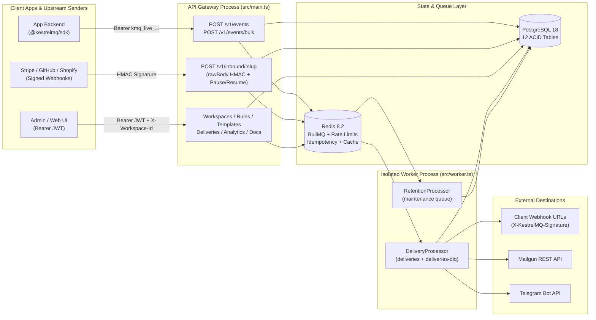

# KestrelMQ

**Self-hosted, multi-tenant notification orchestration and guaranteed webhook delivery platform.**

KestrelMQ decouples outbound notifications (Webhooks, Email via Mailgun, Telegram Bot API) and inbound third-party webhooks (Stripe, Shopify, GitHub, Custom HMAC) from primary application backends with transactional persistence, BullMQ exponential backoff retries, cryptographic secret storage, and zero-downtime deployment buffering.

---

## Core Capabilities

- **Strict API vs. Worker Separation:** The HTTP API Gateway (`src/main.ts`) validates, persists, and enqueues events in `<10ms` (`202 Accepted`) without ever performing external HTTP calls. Isolated background workers (`src/worker.ts`) execute deliveries, decrypt credentials in memory, and record audit trails.
- **At-Least-Once Delivery & Jittered Backoff:** Automatic retry progression (`10s -> 1m -> 5m -> 30m -> 2h` with ±10% jitter, max 5 attempts), fatal `4xx` vs. transient `429`/`5xx`/network classification, Dead Letter Queue (`deliveries-dlq`), and manual `Replay` / `Cancel`.
- **Cryptographic Security:**
  - `AES-256-GCM` AEAD encryption at rest for provider credentials and inbound signing secrets.
  - `SHA-256` hashed workspace API keys (`kmq_live_...`) with 300s Redis lookup caching.
  - `Argon2id` user password hashing + atomic Redis Lua refresh-token rotation with OAuth 2.0 reuse detection.
  - Outbound `X-KestrelMQ-Timestamp` + `X-KestrelMQ-Signature` (`v1=<hmac-sha256>`) webhook signing.
  - Recursive sensitive-key redaction across logs and `delivery_attempts` audit snapshots.
- **Routing, Templating & Schema Contracts:** Wildcard (`order.*`, `*`) and prototype-safe JsonLogic rule evaluation, sandboxed Handlebars templates with Bring-Your-Own-Template (BYOT) fallback, Sample-to-Schema JSON Schema inference, and Ajv validation (`DISABLED`, `WARN`, `STRICT`).
- **Inbound Webhook Gateway & Buffering:** Constant-time `rawBody` HMAC verification (`Stripe`, `Shopify`, `GitHub`, `Custom HMAC`), ingress/egress rate shaping, and `Pause` / `Resume` buffering during downstream deployments or migrations.
- **High-Throughput Operations:** Backpressure-driven RFC 4180 streaming CSV bulk ingestion (`POST /v1/events/bulk`), zero-`OFFSET` keyset cursor pagination, plan-aware Redis ZSET sliding-window rate limiting, 60s Cache-Aside analytics (`PERCENTILE_CONT(0.95)`), and daily plan-aware retention cleanup.
- **Typed SDK & OpenAPI Docs:** Zero-dependency `@kestrelmq/sdk` TypeScript client with RFC 9457 `KestrelApiError` parsing and interactive Swagger UI at `/docs`.

---

## Architecture Overview



---

## Technology Stack

| Layer | Technology |
| :--- | :--- |
| **Runtime & Language** | Node.js 26 LTS (`>=22.12.0` compatible), TypeScript 6.0 (`strict`, ESM `nodenext`) |
| **Framework** | NestJS 12 (`@nestjs/platform-express`, `@nestjs/bullmq`, `@nestjs/swagger`) |
| **Database & ORM** | PostgreSQL 18 Alpine + Prisma 7 (`prisma-client` ESM generator + `@prisma/adapter-pg`) |
| **Queues & Caching** | Redis 8.2 Alpine + BullMQ 6 + `ioredis` Lua scripts |
| **Testing** | Vitest 5 + `@testcontainers/postgresql` & `@testcontainers/redis` |

---

## Quickstart

### 1. Configure Environment Variables

Copy `.env.example` to `.env` and generate cryptographic secrets:

```bash
cp .env.example .env
```

Generate random secrets with OpenSSL and populate `.env`:

```bash
# Generate 64-hex-char AES-256-GCM master key (32 bytes) and distinct signing secrets:
openssl rand -hex 32   # -> ENCRYPTION_MASTER_KEY
openssl rand -hex 32   # -> APP_SECRET
openssl rand -hex 32   # -> JWT_ACCESS_SECRET
openssl rand -hex 32   # -> JWT_REFRESH_SECRET
```

### 2. Local Development (Infrastructure in Docker, App on Host)

Start PostgreSQL 18 and Redis 8.2:

```bash
docker compose up -d postgres redis
```

Install dependencies, generate the Prisma 7 ESM client, and apply migrations:

```bash
npm install
npx prisma generate
npx prisma migrate deploy
```

Start the **HTTP API Gateway** and the **Background Worker** in separate terminals:

```bash
# Terminal 1 — HTTP API Gateway (http://localhost:3000)
npm run start:dev

# Terminal 2 — Standalone BullMQ Worker (no HTTP listener)
npm run start:worker:dev
```

### 3. Full Production Deployment with Docker Compose

Build the multi-stage Alpine image (runs as non-root `USER node`) and start `postgres`, `redis`, `api`, and `worker`:

```bash
docker compose --profile full up --build -d
```

Or build and run the immutable image directly with separate entrypoints:

```bash
docker build -t kestrelmq:latest .

# Run HTTP API Gateway
docker run --rm -p 3000:3000 --env-file .env kestrelmq:latest node dist/main.js

# Run Isolated BullMQ Worker
docker run --rm --env-file .env kestrelmq:latest node dist/worker.js
```

---

## Interactive OpenAPI / Swagger Documentation (`/docs`)

When the API Gateway is running, open:

- **Swagger UI:** `http://localhost:3000/docs`
- **OpenAPI 3.0 JSON Spec:** `http://localhost:3000/docs-json`

Click **Authorize** in Swagger UI to authenticate using either:
1. **`bearerAuth` (`JWT`):** Paste an `accessToken` from `POST /v1/auth/login` (supply your workspace UUID in the `x-workspace-id` header parameter for workspace-scoped routes).
2. **`apiKey` (`x-api-key`):** Paste a workspace API key (`kmq_live_...`) generated via `POST /v1/workspaces/:id/api-keys` for event ingestion, delivery inspection, replay/cancel, and analytics endpoints.

---

## `@kestrelmq/sdk` Usage

Build the standalone zero-dependency TypeScript SDK in `sdk/`:

```bash
npm run sdk:build
```

### Sending Events, Bulk CSV Uploads, Cursor Pagination & Analytics

```ts
import { readFile } from 'node:fs/promises';
import { KestrelApiError, KestrelClient } from '@kestrelmq/sdk';

const kestrel = new KestrelClient({
  baseUrl: 'http://localhost:3000',
  apiKey: process.env.KESTREL_API_KEY!, // kmq_live_...
  timeoutMs: 10_000,
});

try {
  // 1. Ingest an idempotent outbound event (optional delayed execution via deliverAt)
  const receipt = await kestrel.events.send({
    event: 'order.paid',
    payload: {
      orderId: 'ord_9001',
      amount: 149.99,
      customer: { name: 'Ada Lovelace', email: 'ada@example.com' },
    },
    idempotencyKey: 'order-paid-ord_9001',
    deliverAt: new Date(Date.now() + 60_000), // optional schedule
  });
  console.log('Created deliveries:', receipt.deliveryIds);

  // 2. Stream/upload a bulk CSV batch (Blob, Buffer, string, or Readable stream)
  const csvBuffer = await readFile('./events.csv');
  const bulk = await kestrel.events.sendBulk(csvBuffer, { filename: 'events.csv' });
  console.log(`Imported ${bulk.importedEvents}/${bulk.totalRows} events`);

  // 3. Keyset cursor pagination over deliveries
  const page = await kestrel.deliveries.list({ limit: 20, status: 'FAILED' });
  for (const delivery of page.data) {
    const detail = await kestrel.deliveries.get(delivery.id);
    console.log(detail.id, detail.attempts.length);
    await kestrel.deliveries.replay(delivery.id);
  }

  // 4. Workspace analytics summary (24h | 7d | 30d)
  const metrics = await kestrel.analytics.summary('24h');
  console.log(`Success rate: ${metrics.successRate}%, p95: ${metrics.p95DurationMs}ms`);
} catch (error) {
  if (error instanceof KestrelApiError) {
    // Typed RFC 9457 Problem Details (application/problem+json)
    console.error(error.status, error.type, error.detail, error.errors);
    if (error.status === 429 && error.retryAfterSec !== null) {
      console.error(`Rate limited — retry after ${error.retryAfterSec}s`);
    }
  }
}
```

### Verifying Outbound Webhook Signatures (`X-KestrelMQ-Signature`)

Outbound webhooks attach `X-KestrelMQ-Timestamp` (Unix seconds) and `X-KestrelMQ-Signature` (`v1=<hex>`):

```ts
import { createHmac, timingSafeEqual } from 'node:crypto';

export function verifyKestrelWebhook(
  rawBody: string,
  timestampHeader: string,
  signatureHeader: string,
  workspaceSigningSecret: string,
  toleranceSec = 300,
): boolean {
  const timestamp = Number(timestampHeader);
  if (!Number.isSafeInteger(timestamp) || !signatureHeader.startsWith('v1=')) {
    return false;
  }
  if (Math.abs(Math.floor(Date.now() / 1000) - timestamp) > toleranceSec) {
    return false;
  }

  const expected = createHmac('sha256', workspaceSigningSecret)
    .update(`${timestamp}.${rawBody}`, 'utf8')
    .digest();
  const provided = Buffer.from(signatureHeader.slice(3), 'hex');

  return provided.byteLength === expected.byteLength && timingSafeEqual(provided, expected);
}
```

---

## Testing & Verification Commands

```bash
# Strict TypeScript 6.0 typecheck across backend, E2E tests, and @kestrelmq/sdk
npm run typecheck

# Build @kestrelmq/sdk and NestJS production bundles (dist/main.js & dist/worker.js)
npm run sdk:build
npm run build

# Run fast unit test suites (Backend + SDK)
npm test

# Run unit tests with V8 coverage report
npm run test:cov

# Run full E2E integration suite with ephemeral PostgreSQL 18 + Redis 8.2 Testcontainers
npm run test:e2e
```
